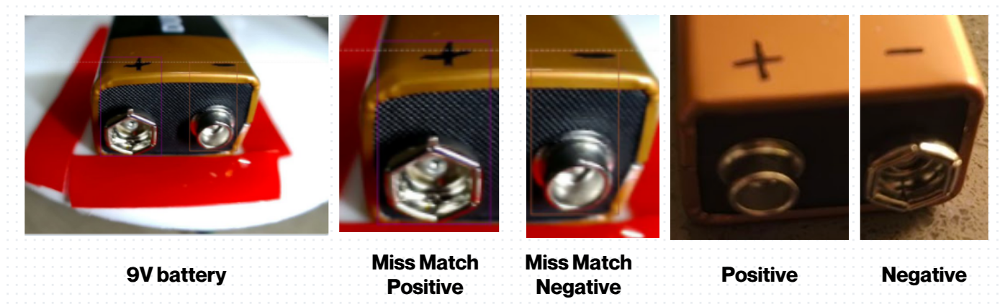
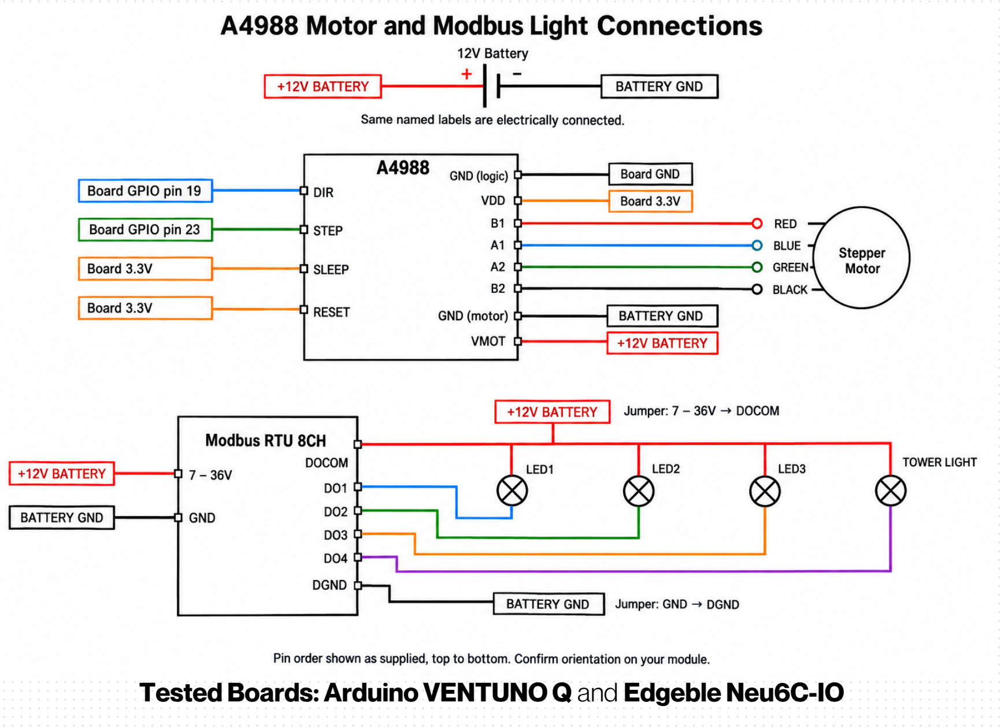
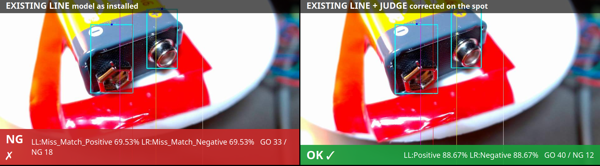
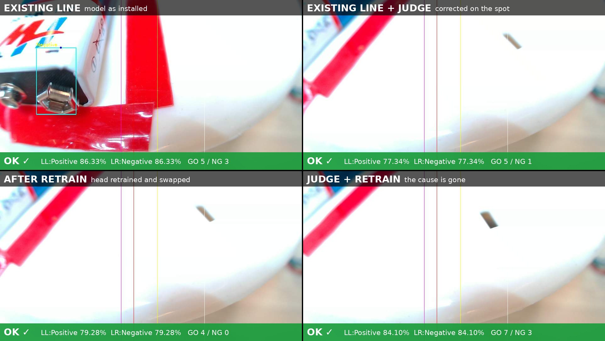

# A self-correcting runtime for deployed vision models

ExecuTorch hackathon, IoT track, Arduino VENTUNO Q. Qualcomm Dragonwing QCS8275, ExecuTorch,
sealed front on the NPU, trainable head on the CPU. **Correct now. Fix forever. Nothing leaves
the device.**

Battery terminal inspection on a rotating rig: a YOLO11n detector runs sealed on the Hexagon NPU of
an Arduino VENTUNO Q through ExecuTorch's Qualcomm backend, and a small float tail of the same
network is retrained **on the device, in seconds**, when the line's conditions make the sealed
model fail. Built at the ExecuTorch hackathon, San Francisco, 17-18 October 2026.

> Status markers: [done] verified on hardware, [pending] in progress, [doc] documented from the
> RK3588 reference pipeline, not run on the Q.
>
> What is in this repository (Apache-2.0): the ExecuTorch runner, the model recipe, the on-device
> learning loop, the Q setup and tools, the demo model as `.pte`, the logs and the videos. What is
> referenced but not included: edgeble-infer, Edgeble's production inference engine (used here as
> the application host, shipped in the container image), and the correction runtime and toolchain.
> The self-correction architecture and methods are patent pending: Indian patent application filed; international (US) filing in progress.

## 1. The problem we show

A factory model ships trained under one lighting setup (all three strips on). The night rule
turns two strips off; the camera is locked to the day baseline; the model starts calling good
batteries `Miss_Match`. That is a false positive the factory cannot ship. Two things must happen
on the device, without a cloud and without the vendor:

1. **Correct**: a wrong label is caught at the decision point and fixed in milliseconds, against
   examples the line itself confirmed. The judged model never judges itself.
2. **Find the layer**: the lamp or the model? The runtime measures which one failed and fixes
   that one. It never retrains for a broken lamp: the strip state is known to the runtime.
3. **Learn and prove**: when the model is behind, its head retrains on the board, passes a
   learning and a forgetting check, and swaps in, with rollback. The sealed NPU part is never
   touched.

```
camera -> model -> judge -> decision -> tower light
```

## Team

| | |
|---|---|
| Akhil Beeram <akhil@edgeble.ai> | model, correction, board, stepper motor, lights |
| Aharone Routu <aharone@edgeble.ai> | Edgeble inference, board, stepper motor, lights |
| Buji Mamidipalli <bujji@edgeble.ai> | model, correction |
| Rithwik Beeram <rithwik@edgeble.ai> | model, correction, board |
| Jagan Teki <jagan@edgeble.ai> | Arduino VENTUNO Q, ExecuTorch, correction, demonstration |

## 2. The stack

```
+--------------------------------------------------------------------------+
| demo        rig: stepper ring, three LED strips, USB camera, HTTP stream  |
+--------------------------------------------------------------------------+
| correction  judge at the decision point, lamp-or-model, retrain +         |
|             hot-swap on the board (Edgeble, patent pending)               |
+--------------------------------------------------------------------------+
| edgeble-infer   usecase/resin (gate, counting, outputs)                   |
|  (ours, C/C++)  lib/ (capture, track, stream, post-process)               |
|                 platform/qcom: yolo_runner_executorch (A.pte, A+B.pte)    |
+--------------------------------------------------------------------------+
| ExecuTorch 1.5.1 runtime + Qualcomm backend (static, aarch64)             |
+--------------------------------------------------------------------------+
| QAIRT / QNN HTP runtime: libQnnHtp, V75 stub, V75 skel + DSP library      |
+--------------------------------------------------------------------------+
| Ubuntu 24.04 (kernel 6.8 qcom), fastrpc, docker                            |
+--------------------------------------------------------------------------+
| Arduino VENTUNO Q: Qualcomm Dragonwing IQ8 / QCS8275, Hexagon V75          |
+--------------------------------------------------------------------------+
```

Host side (laptop, docker): Ultralytics training -> `export_pte.py` (ExecuTorch
1.5.1 + QCS8275 chipset patch, PT2E quantization, QNN HTP delegate) -> `.pte`; the ExecuTorch
runtime cross-built for aarch64; edgeble-infer built as an arm64 container image and shipped over USB.

## 3. Our own model

The detector is **not** a stock checkpoint. It is a YOLO11n fine-tuned by Edgeble on frames of this
rig: four classes, `positive`, `Negative`, `Miss_match Positive`, `Miss_match_Negative`, the two
terminals of a 9 V battery and their swapped placements. Training data: USB-camera captures of the
ring under the day lighting, labelled by us (Ultralytics, `9v-bat-2.pt`, 2026-10-18). The model
was then quantized and sealed for the Hexagon by our own export recipe (section 5), and its class
tail is the part that learns on the device. [Jagan: dataset size, epochs, mAP]



## 4. Hardware



| part | detail |
|---|---|
| board | Arduino VENTUNO Q, Qualcomm Dragonwing IQ8 / QCS8275, Hexagon V75, Ubuntu 24.04 |
| camera | USB UVC, 1080p MJPG |
| rig | NEMA stepper on an A4988 (STEP/DIR on the 40-pin header), three LED strips on Modbus RTU outputs (RS485 USB adapter), 9 V batteries on a rotating ring |
| reference | the same rig on an RK3588 unit, where the cases were recorded and the correction pipeline was developed |

Wiring (40-pin header, odd row): pin 1 3.3 V, pin 19 DIR (gpiochip2 line 26), pin 23 STEP (line 27),
pin 39 GND. Lights: `/dev/ttyACM1`, slave 1, 9600 8N1, coils 1..3.

## 5. Model: sealed front, trainable head

The same trained network is shipped in two forms. The **sealed** form is the whole detector as one
`.pte`, int8, one QNN delegate on the Hexagon: `model/9v-bat-2_QCS8275_8a8w.pte`, float32 in and
out. [done] The **sealed front + trainable head** form keeps the front of the network sealed on
the NPU and leaves a small head in float on the CPU, the part that learns on the device; its
layout is Edgeble's and not part of this repository. The runner here loads either form.

Recipe for the sealed form (laptop, docker, `docs/model-recipe.md`; section 3 for the training):
Ultralytics `.pt` -> nine-output head (per scale: box DFL logits, class sigmoid, score sum) ->
`torch.export` -> PT2E int8 (8-bit activations with the Histogram observer, per-channel 8-bit
weights, 70 calibration frames from the rig) -> lowered to the QNN HTP delegate for QCS8275 ->
`.pte`. The chipset was added to ExecuTorch 1.5.1 (not in the upstream table yet). Parity on the
calibration frames: boxes within 3 px of float, scores within 0.05. [done]

## 6. edgeble-infer: our inference engine on the Q

**Why edgeble-infer when there is ExecuTorch?** They are different layers. ExecuTorch executes a
model: it takes a `.pte`, runs the delegate on the Hexagon, returns tensors. It has no camera, no
tracker, no gate logic, no results log, no outputs, and no idea what a false positive is.
edgeble-infer is the application that owns the frame from the camera to the tower light: capture,
letterbox, tracking across frames, the inspection decision, the stream, the motor and the strips,
and the hooks where the correction layer judges and learns. ExecuTorch is the model runtime inside
it, exactly where RKNN sits on the RK3588 units. Without ExecuTorch we would have no trainable
head on the device; without edgeble-infer there would be nothing to correct.

edgeble-infer is Edgeble's own C/C++ inference engine, the same code that runs the resin line on
RK3588 units in production. It is vendor-neutral: everything above the runner is shared, and each
SoC gets a `platform/<soc>` layer that owns the vendor runtime.

```
edgeble-infer/
  app/main.cpp            the binary (one for every usecase, chosen at run time by in:<usecase>)
  lib/                    capture (V4L2/UVC, video), ByteTrack, HTTP stream + dashboard,
                          backend-neutral YOLO post-processor (ed_tensor_t), logging, Modbus
  usecase/resin/          the battery usecase: gate, pairing of the two terminals, results log,
                          motor and strip controller, and the correction hooks
  platform/rk3588/        RKNN runner, RGA, DMA heap (the production platform)
  platform/qcom/          this hackathon: QNN runner + ExecuTorch runner, CPU letterbox, OpenCV
    model/qcom_runner.h          the runner seam: init / run / release / aux (tail inputs)
    model/yolo_runner_qcom.cpp   the dispatcher: picks the runner by the model file, dumps
                                 frames + tail inputs + detections for training
    model/yolo_runner_executorch.cpp  ExecuTorch Module API: a sealed .pte, or A.pte + B.pte/B.ptd
    model/yolo_runner_qnn.cpp         the direct QNN context-binary path (fallback, no ExecuTorch)
```

What the ExecuTorch runner does per frame: letterbox on the CPU, `forward` on A (the delegate
runs on the Hexagon), the three feature maps into `forward` on B (float, CPU, weights from
`B.ptd`), and `[box, cls, sum] x 3` into the same post-processor the RK3588 uses. With
`EDGEBLE_FEAT_DUMP=<dir>` it writes every n-th frame, its tail inputs and its detections, the
material the retrain consumes. A new `B.ptd` is picked up at the next start: that is the hot swap.

Build: `./build.sh -p qcom -z <QAIRT headers> -e <ExecuTorch install>`; one binary carries both
runners. On the Q it ships as an aarch64 container image (the board has no compiler) and runs with
the Hexagon devices and the QNN libraries mounted (`tools/q-run.sh`). Picture: HTTP stream on
port 8080, dashboard on 8081. [pending: Hexagon runtime version for this SoC]

## 7. The two cases

Recorded on the rig with the RK3588 unit on 2026-10-18 (`docs/cases.md`, result logs in `logs/`):

| case | condition | live result |
|---|---|---|
| 1 | good and bad batteries, all strips on | 16 batteries: 10 Positive+Negative, 6 Miss_Match (the bad ones) |
| 2 | same batteries, one strip on, camera on auto | 48 batteries: 33 GO, 15 Miss_Match on good batteries = the false positives |

Replay of the joined clips through the same binary reproduces the pattern (counts differ because
the replay sees every frame). [done on RK3588, pending on the Q]

### What it looks like

A genuine false positive and its correction, recorded in the hotel on the mixed clip, same frames in both
panes. Left, the model as installed: a good battery under one light strip read as Miss_Match on both
terminals, NG. Right, the same frames through the judge: Positive and Negative, OK. The counters are the
running totals of that run, 33/18 against 40/12.



The four panes live on the Q at the venue, all from one camera through the camera tee, all three light
strips on: model as installed, model with the judge, the retrained head, the retrained head with the judge.



## 8. The correction loop

Correct now, find the layer, fix forever (section 1). On the device the loop is: the judge flags a
wrong label at the decision point; the runtime tells a lamp problem from a model problem; when it
is the model, the trainable head learns from the corrected frames on the board, passes a learning
and a forgetting check, and swaps in, with the previous head kept for rollback. The sealed front
on the NPU never changes. The retrain of the head takes seconds on the board; the full retrain and
requantize of the model is the slow path, 20 to 90 minutes, documented with its logs.
The method is Edgeble's, patent pending (India filed, US in progress); the procedure and the training recipe are not
part of this repository. What is shown: the results, the logs and the video.

## On-device performance and load (VENTUNO Q, measured 2026-10-18)

Measured on the board while the demo ran, `docker stats` for the engine container, `qcnpuperf_cli`
for the Hexagon, the engine's own per-frame timing (`EDGEBLE_PERF=1`).

| | sealed model (all on the NPU) | sealed front + head (front on the NPU, head on the CPU) |
|---|---|---|
| input | USB camera, 1080p MJPG, 30 fps | the mixed clip, 1080p, software decode |
| inference per frame | 9.5 ms | 26 ms (front on the NPU, head on the CPU, two programs) |
| end-to-end latency | 17 ms | 62 ms |
| frame rate | 30 fps (camera-bound) | 30 fps (clip-bound) |
| Hexagon load | scalar 6.7 %, HVX 5 %, HMX 1 % at 1.5 GHz | about 7.8 % scalar, 6 % HVX (14.5 % total with the other instance running) |
| engine CPU | 1.0 core of 8 (MJPG decode, letterbox, stream) | 2.6 cores of 8 (software video decode dominates) |
| engine memory | 259 MB | 205 MB |
| board | 15 GB RAM, 40 C hottest zone, no throttling | same |

The NPU is nearly idle at 30 fps either way; the CPU cost is video decode and the letterbox, not
the model. The head retrain on the board (10 epochs over 930 dumped frames) took 7.6 minutes of
CPU inside a Python container and 4.9 KB of weights were swapped in; the inference container was
unaffected while it ran.

## Self-correction performance (what was measured, 2026-10-18)

| quantity | number | where |
|---|---|---|
| false positives under the night rule, live on the RK3588 (case 2, 12 min) | 15 of 48 batteries read Miss_Match although good | `logs/case2-live-results.txt` |
| false positives in the one-strip segment of the mixed clip, on the Q, sealed front + shipped head | 3 of 14 batteries in that segment | `logs/q-mixed-retrain1-vs-shipped.txt`, pane d |
| genuine mismatches kept after the head retrain (forgetting check) | all, same lines as the shipped head | same file, pane c |
| false positives removed by the retrained head, iteration 1 (17 corrected detections, 10 epochs, 7.6 min on the board) | none; 5 against 3, worse | same file |
| false positives removed by the retrained head, iteration 2 (41 corrected detections from a denser dump, 20 epochs) | pending at submission time; result appended to `logs/` when it lands | |
| corrections by the judge on the Q, mixed clip, two passes, 49 battery decisions (`logs/judge/`) | model as installed: 16 NG / 33 GO. With the judge: 10 NG / 39 GO. 6 decisions changed from NG to GO, all of them good batteries read as mismatch under one strip; 0 changed from GO to NG, every genuine mismatch kept. | `logs/judge/results-a.log` vs `results-b.log`, same frames, same binary, started together |
| judge verdicts on the Q, per terminal | 77 judged: 46 confirmed, 22 abstained (margin under 0.05), 9 flipped, 0 skipped for crop validity. 6 ms to 109 ms per verdict, median 15 ms, on the Hexagon next to the detector. | `logs/judge/judge-verify.log` |
| judge embedding | the detector's own backbone (layers 0 to SPPF, global average pool, 256-d), exported as a second sealed `.pte`, int8, 1.3 MB; bank of 390 confirmed terminal crops built on the board from the good-light run; mean-centred cosine distance. On the float backbone the nearest-example class is right for 96% of held-out crops; without centring only 24% of crops have a usable margin, with it 93%. | `model/9v-bat-2-embedding.pte`, `tools/export_embedder_yolo.py` |
| corrections by the judge on the RK3588 reference pipeline (own embedder, bank of confirmed parts) | 7 of 9 false positives flipped, 13 ms each, in the resin-line validation | Edgeble's internal validation, not part of this repository |

What this says, honestly: the judge on the Q corrects the lighting false positives at the decision
point (6 of 16 NG decisions on the mixed clip, no genuine mismatch lost) and abstains where the
example bank is not clear. The on-device loop, dump, correct, retrain the head in minutes, swap,
re-run, runs end to end on the Q; the retrain recipe has not yet removed the lighting false positives
on this model. The sealed inference, the two cases, the judge and the performance numbers are
measured; the numbers above are the ones we have, not the ones we want.

The judge is not the model judging itself: it is a bank of examples the line confirmed, compared
against the terminal crop with the same frozen backbone the detector runs. Three things made it work
on the Q tonight, all in the logs: the bank crops must be cut from the same letterbox the detector
saw (a coordinate mismatch had produced a bank with zero class margin), the embedding is centred on
the bank's mean before the cosine distance, and the crop validity gate (brightness, sharpness) is
tuned for the one-strip lighting instead of the daylight default.

## Quick start (reproduce on a VENTUNO Q)

1. Laptop: build the export image and export the model (`docs/model-recipe.md`), or use
   `model/9v-bat-2_QCS8275_8a8w.pte` as is.
2. Laptop: build the ExecuTorch aarch64 runtime once (`tools/build-aarch64.sh`) and the edgeble-infer
   container image (`tools/Dockerfile.edgeble-infer-q`), `docker save` it.
3. Board: `docker load` the image; the Hexagon runtime libraries that accept this chip are the QNN 2.30
   set shipped in Arduino's own `ei-qnn-models-runner` container (QAIRT 2.37 and 2.50 refuse SoC model 82);
   copy them to `~/jagan/qnn-libs-ei` (`docs/ventuno-q-notes.md`), the `.pte` and its label file to
   `~/jagan/model`, a clip to `~/jagan/video`. The container needs `/dev/fastrpc-cdsp*` and `/dev/dma_heap/*`.
4. Board: `tools/q-run.sh ~/jagan/video/<clip>.mkv` or `tools/q-run.sh usb` for the camera; picture at
   `http://<board>:8080` (`/snapshot` for a still), dashboard `:8081`. Motor and strips: `tools/motor.sh`,
   `tools/lights.sh`. All four panes at once: `tools/q-grid.sh start <clip>|usb` (the camera is shared
   through `tools/cam-tee.sh`), the 2x2 page `tools/status4.py` on `:8082`. Pin map: `docs/run-on-q.md`.
5. Board, the judge: the bundle directory (`adapt.conf`, `verify.conf`, the embedding `.pte`, the bank)
   mounted at `/gt` with `EDGEBLE_GT=/gt`; the bank is built on the board from a good-light run with
   `ec-bank` (`docs/runbook.md`). Without a bundle the engine runs exactly as before.

## 9. Repository layout

```
executorch-runner/   the C++ ExecuTorch runner (sealed .pte, and the sealed-front + trainable-head pair), the open part of edgeble-infer
tools/               export (detector and embedder), calibration, runtime build, container, Q run/grid/camera-tee/motor/light tools, the 2x2 page
model/               the sealed detector .pte, the embedding .pte, labels, export log (no .pt, no dataset)
docs/                step-by-step: model recipe, running on the Q, the cases, board notes, the runbook; docs/images: rig, annotation, the panes
logs/                live and replay result logs for the two cases, the judge run (logs/judge), the switch timeline
```

## 10. Limitations, honestly

- QAIRT 2.37.1's Hexagon libraries refuse the IQ8 ("Unsupported SoC model 82"); 2.50.0 under test.
- the judge's thresholds (confirm 0.60, novel 0.80, margin 0.05, crop brightness 15) were set on this
  clip; a different line tunes them from its own good-light run.
- Lighting false positives depend on the room; the recorded videos are the deterministic input.
